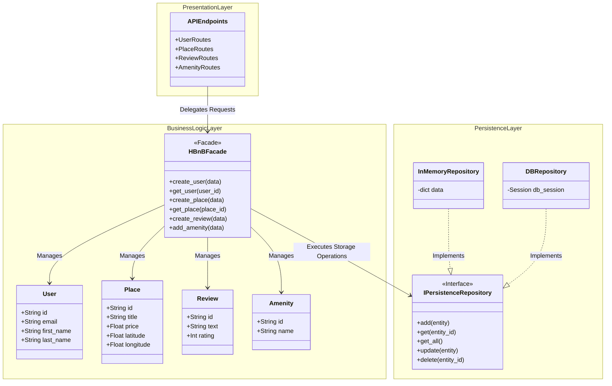

# HBnB - High-Level Architecture & Package Structure

This project follows a 3-Tier Layered Architecture decoupled by the **Facade Pattern** to maintain separation of concerns, high cohesion, and low coupling.

---

## 1. High-Level Package Diagram

---

## 2. Layer Architecture Overview

| Layer | Primary Components | Key Responsibilities |
| :--- | :--- | :--- |
| **Presentation Layer** | API Endpoints, Controllers | Receives HTTP requests, validates input DTOs, routes requests to the Facade, and returns structured JSON responses. |
| **Business Logic Layer** | `HBnBFacade`, Core Models (`User`, `Place`, `Review`, `Amenity`) | Enforces domain rules, manages model state/relationships, and coordinates entity operations through the Facade. |
| **Persistence Layer** | `IPersistenceRepository`, `InMemoryRepository`, `DBRepository` | Abstracted storage interface managing persistent operations (CRUD), allowing transparent switching between memory and SQL databases. |

---

## 3. Facade Pattern Design

The **`HBnBFacade`** serves as the single entry point for all API operations interacting with the business logic and persistence tiers:

* **Unified API Interface:** Isolates endpoints from underlying model instantiation logic or repository calls.
* **Decoupled Architecture:** Internal refactoring of entity methods or persistence engines requires zero changes to the API controllers.
* **Execution Pathway:**
  1. `APIEndpoints` receives request payload $\rightarrow$ calls `HBnBFacade` method (e.g., `facade.create_place(data)`).
  2. `HBnBFacade` validates attributes, instantiates `Place`, and invokes `IPersistenceRepository.add(place)`.
  3. Result object is passed back to `APIEndpoints` to construct the HTTP response.
