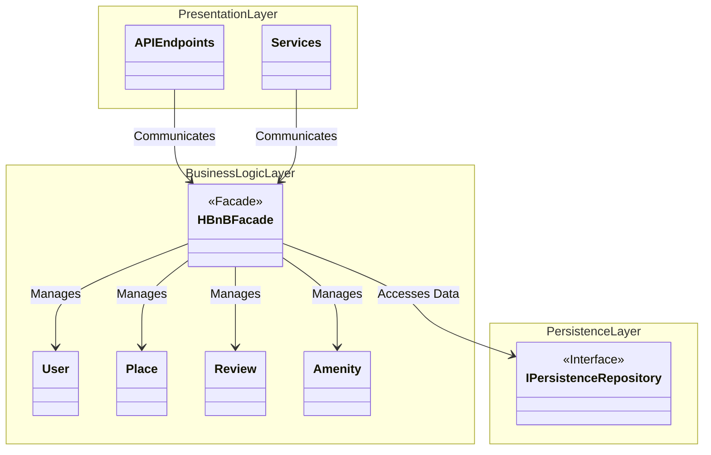
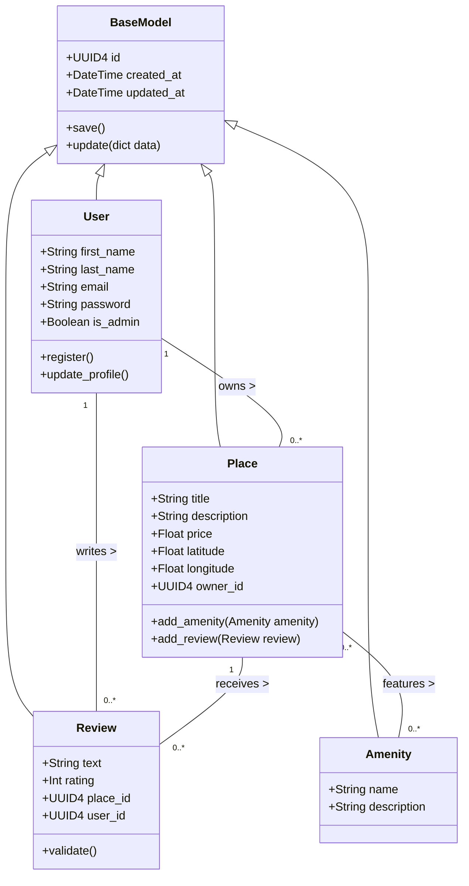
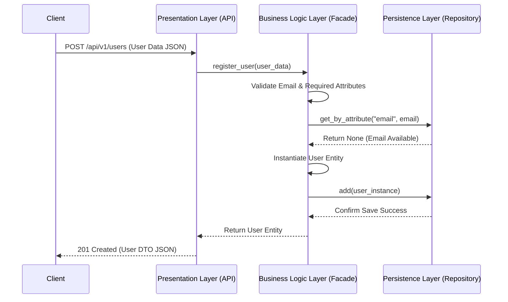
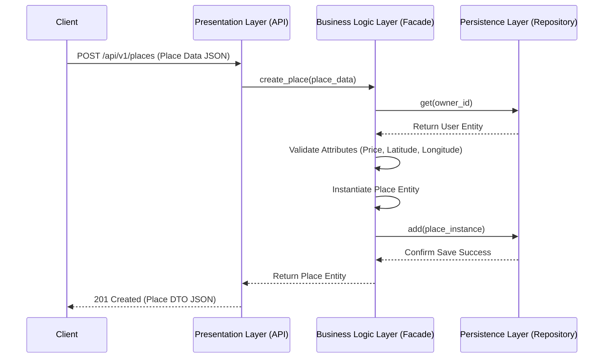
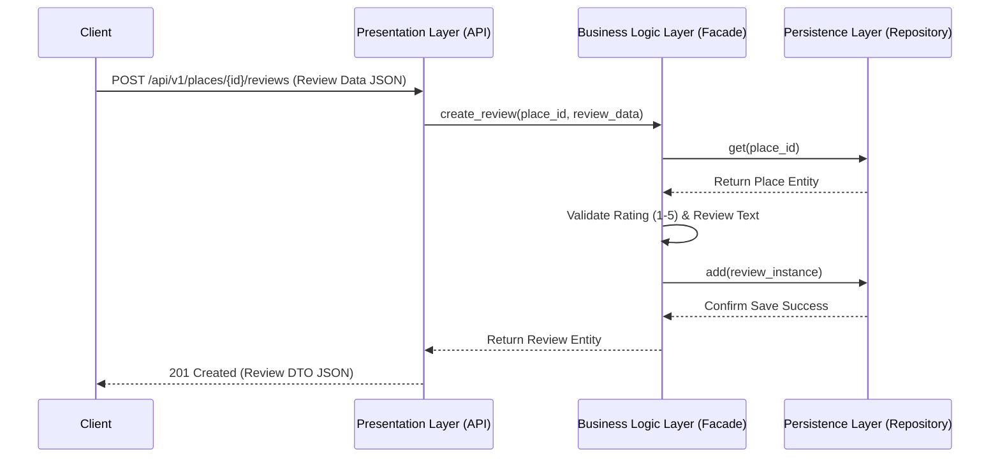
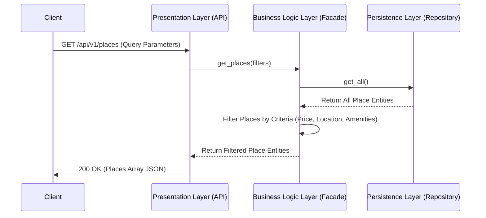

# HBnB Technical Architecture & Design Document

## 1. Introduction

This document serves as the comprehensive technical blueprint for the **HBnB** application. It details the system architecture, core domain models, layer interaction patterns, and execution flows for key application use cases. Designed following strict object-oriented and layered software design principles, this documentation guides the implementation phases to ensure high cohesion, low coupling, and maintainability.

---

## 2. High-Level Architecture

The HBnB application adheres to a 3-tier layered architecture decoupled by the **Facade Pattern**.

### Package Diagram

### Layer Descriptions & Facade Pattern Overview

* **Presentation Layer:** Contains API endpoints and services. Handles user/client interaction by validating HTTP requests and formatting structured JSON responses. It has no direct connection to storage engines.
* **Business Logic Layer:** Encapsulates domain logic, entity definitions (`User`, `Place`, `Review`, `Amenity`), and business rules. It contains the `HBnBFacade`, which acts as the entry interface for presentation callers.
* **Persistence Layer:** Handles data storage and retrieval via repository patterns (`IPersistenceRepository`). Abstracts underlying storage mechanisms (in-memory or relational databases) from upper layers.
* **Facade Pattern Communication:** The `HBnBFacade` provides a unified entry point, isolating the Presentation Layer from internal entity instantiations and persistence operations.

---

## 3. Business Logic Layer

### Detailed Class Diagram

### Entity & Relationship Notes

* **`BaseModel`:** Abstract parent class containing core attributes shared across entities: unique identifier (`id` via UUID4) and audit timestamps (`created_at`, `updated_at`).
* **`User`:** Encapsulates user profile details and credentials. Holds a 1-to-many relationship with `Place` (as owner) and `Review` (as author).
* **`Place`:** Defines property listing parameters. Relates to `User` via `owner_id`, possesses a 1-to-many association with `Review`, and maintains a many-to-many relationship with `Amenity`.
* **`Review`:** Stores feedback and rating data, maintaining foreign reference links (`place_id`, `user_id`) to connect users and places.
* **`Amenity`:** Represents listing features or services (e.g., Wi-Fi, Pool) associated with places.

---

## 4. API Interaction Flow

### 1. User Registration (`POST /api/v1/users`)

* **Purpose & Flow:** Handles new user onboarding. The API delegates payload verification to `facade.register_user()`. The facade verifies email uniqueness, instantiates `User`, and instructs the repository to persist the object before returning HTTP 201.

---

### 2. Place Creation (`POST /api/v1/places`)

* **Purpose & Flow:** Manages listing additions. The API sends details to `facade.create_place()`, which checks the persistence layer to confirm `owner_id` validity, verifies location and price constraints, saves the `Place` instance, and returns the response.

---

### 3. Review Submission (`POST /api/v1/places/{id}/reviews`)

* **Purpose & Flow:** Processes feedback submissions. The facade confirms target `place_id` existence in storage, enforces rating limits (1–5 stars), generates the `Review` entity, and records it via the repository layer.

---

### 4. Fetching a List of Places (`GET /api/v1/places`)

* **Purpose & Flow:** Executes place queries. The API passes search parameters to the facade, which retrieves stored entities from the persistence repository, executes filtering logic, and returns the formatted collection in a HTTP 200 JSON payload.
